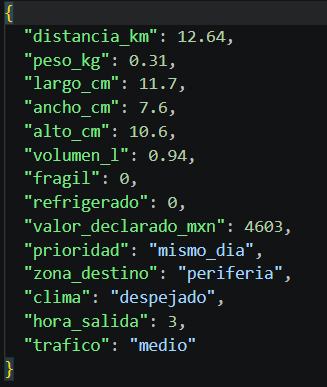
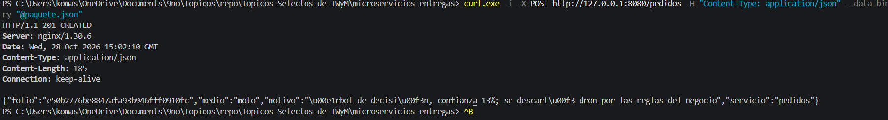
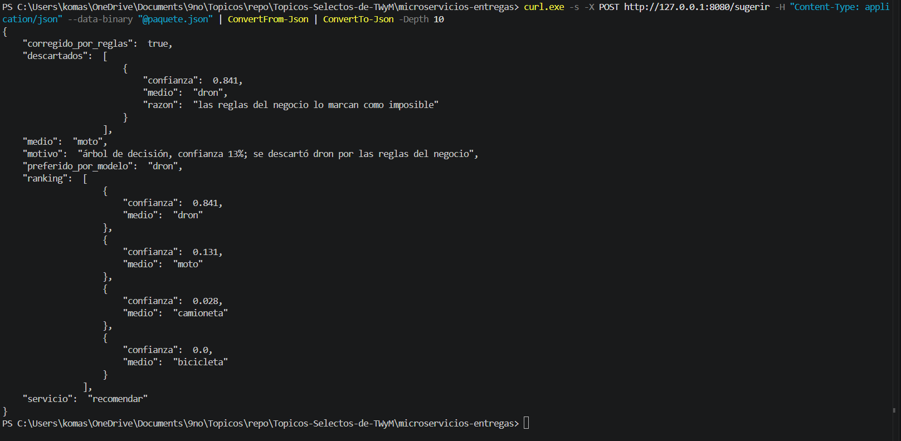
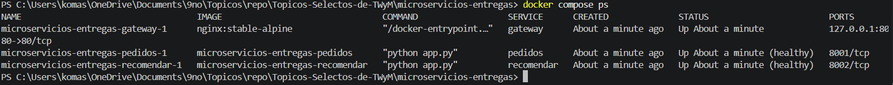
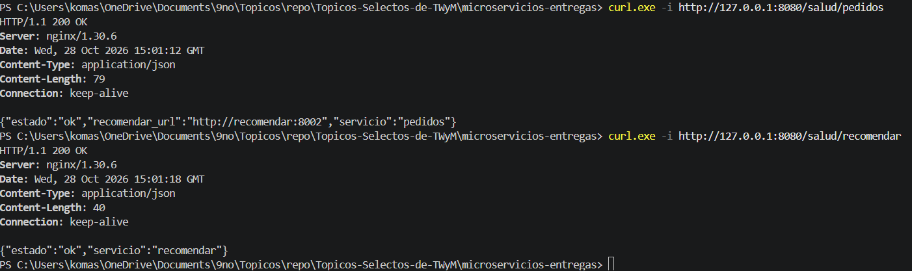
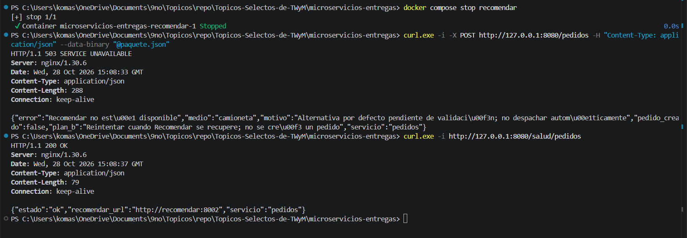
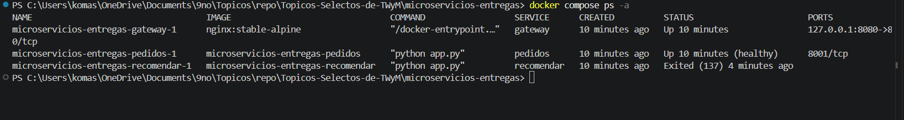
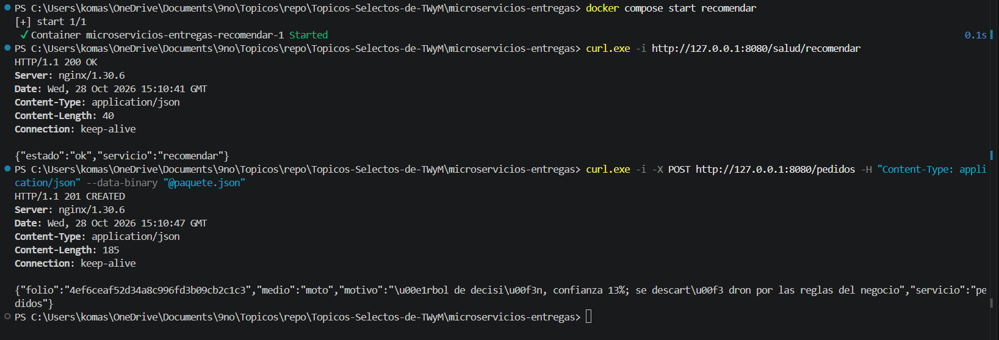

# Actividad — Microservicios con Docker

Nombre: Annatar Armando Murillo Rivera
Matrícula: 22121283
Equipo: 6

> **Nota sobre las evidencias:** la práctica la hicimos en equipo con Cesar Figueroa Merino (22121299). Las pruebas se corrieron en una sesión conjunta en su computadora (yo me encargué de la conexión a su red), por eso las capturas muestran su ruta de trabajo y los mismos folios que su informe. El código de la práctica está en `microservicios-entregas/` de mi repositorio.

## 1. Predicción (hora 3) vs resultado

### Predicción

Antes de correr la prueba, pensé que el medio elegido iba a ser **moto**.

Paquete de prueba (`paquete.json`):

| Campo | Valor |
|---|---|
| distancia_km | 12.64 |
| peso_kg | 0.31 |
| largo / ancho / alto | 11.7 × 7.6 × 10.6 cm |
| volumen_l | 0.94 |
| fragil / refrigerado | 0 / 0 |
| valor_declarado_mxn | 4 603 |
| prioridad | mismo_dia |
| zona_destino | periferia |
| clima | despejado |
| hora_salida | 3 |
| trafico | medio |



Mi razonamiento con `reglas.py`:

- **Bicicleta:** imposible, porque 12.64 km pasa su límite de 7 km.
- **Dron:** imposible, porque a las 3:00 es de noche (la regla marca noche si `hora_salida >= 21` o `< 6`). Además, por peso y distancia sería el candidato natural, así que esperaba que el modelo lo prefiriera y que las reglas lo quitaran.
- **Moto:** posible; peso, volumen y distancia están dentro de sus límites y no es refrigerado.
- **Camioneta:** también posible.

Entre moto y camioneta, apostaba por moto porque es un paquete muy ligero que va a una distancia media; la camioneta está pensada para carga pesada o refrigerada.

### Resultado

```powershell
curl.exe -i -X POST http://127.0.0.1:8080/pedidos -H "Content-Type: application/json" --data-binary "@paquete.json"
```

Respuesta **HTTP 201 CREATED**:

- servicio: `pedidos`
- folio: `e50b2776be8847afa93b946fff0910fc`
- medio: `moto`
- motivo: `árbol de decisión, confianza 13%; se descartó dron por las reglas del negocio`



Para ver qué pasó por dentro, consulté directamente `/sugerir`:

```powershell
curl.exe -s -X POST http://127.0.0.1:8080/sugerir -H "Content-Type: application/json" --data-binary "@paquete.json" | ConvertFrom-Json | ConvertTo-Json -Depth 10
```

| # | Medio | Confianza |
|---|---|---|
| 1 | dron | 0.841 (84.1 %) |
| 2 | moto | 0.131 (13.1 %) |
| 3 | camioneta | 0.028 (2.8 %) |
| 4 | bicicleta | 0.0 |

```json
{ "preferido_por_modelo": "dron", "corregido_por_reglas": true, "medio": "moto" }
```



### Comparación

Acerté: salió **moto**, y además pasó lo que esperaba con el dron. El modelo lo puso primero con 84.1 % porque, si solo se ven el peso y la distancia, es un paquete típico de dron. El recomendador recorre el ranking de mayor a menor confianza y le pregunta a `es_posible` por cada medio: el dron se descarta por la hora y el siguiente, la moto, sí pasa, así que se queda con ella.

Dos detalles que noté:

- El motivo dice "confianza 13%" porque reporta la confianza del medio **elegido** (moto), no la del preferido.
- En `descartados` solo aparece el dron. La bicicleta también era imposible, pero nunca se revisó, porque el recorrido se detiene en el primer medio posible.

Es lo mismo que vi en el análisis del dataset (actividad 3): la mayoría de los errores "moto → dron" son de noche, y justo esos son los que las reglas corrigen.

## 2. `docker compose ps`: qué hay en cada contenedor

```powershell
docker compose ps
```

| Contenedor | Imagen | Estado |
|---|---|---|
| microservicios-entregas-gateway-1 | nginx:stable-alpine | Up |
| microservicios-entregas-pedidos-1 | microservicios-entregas-pedidos | Up (healthy) |
| microservicios-entregas-recomendar-1 | microservicios-entregas-recomendar | Up (healthy) |



- **gateway:** nginx con `nginx.conf` y el HTML del formulario. Es el único que publica un puerto a la computadora (`127.0.0.1:8080 → 80`) y reparte las rutas: `/pedidos` va a pedidos, `/sugerir` a recomendar, y `/salud/...` a cada uno.
- **pedidos:** Python con Flask y `requests`. Recibe el paquete, le pregunta a recomendar por HTTP, genera el folio con `uuid4` y guarda el pedido en una lista en memoria. No tiene scikit-learn ni el modelo, por eso su imagen es mucho más ligera.
- **recomendar:** Python con Flask, pandas, numpy y scikit-learn. Contiene `recomendador.py`, `reglas.py` y `modelo_medios.joblib`. Solo decide el medio; no crea folios ni guarda pedidos.

Los puertos 8001 (pedidos) y 8002 (recomendar) solo existen dentro de la red de Compose; desde la computadora no se puede llegar a ellos directamente, todo entra por el gateway.

Salud de los servicios:

```powershell
curl.exe -i http://127.0.0.1:8080/salud/pedidos
curl.exe -i http://127.0.0.1:8080/salud/recomendar
```

Las dos respondieron **200 OK**: pedidos con `{"estado":"ok","recomendar_url":"http://recomendar:8002","servicio":"pedidos"}` y recomendar con `{"estado":"ok","servicio":"recomendar"}`. Los `healthcheck` del `docker-compose.yml` usan esas mismas rutas; por eso `ps` marca a los dos como `healthy` y pedidos no arranca hasta que recomendar está sano.



## 3. Fallo al apagar recomendar

### Predicción

Pensé que al apagar recomendar, el gateway y pedidos iban a seguir arriba: un pedido nuevo respondería con error **503** (pedidos no tiene a quién preguntarle), pero `/salud/pedidos` seguiría dando 200, porque esa ruta no depende de recomendar.

### Resultado

```powershell
docker compose stop recomendar
curl.exe -i -X POST http://127.0.0.1:8080/pedidos -H "Content-Type: application/json" --data-binary "@paquete.json"
curl.exe -i http://127.0.0.1:8080/salud/pedidos
```

El POST respondió **503 SERVICE UNAVAILABLE**:

```json
{
  "error": "Recomendar no está disponible",
  "medio": "camioneta",
  "motivo": "Alternativa por defecto pendiente de validación; no despachar automáticamente",
  "pedido_creado": false,
  "plan_b": "Reintentar cuando Recomendar se recupere; no se creó un pedido",
  "servicio": "pedidos"
}
```

Y `/salud/pedidos` siguió en **200 OK**.



`docker compose ps -a` mostró a gateway y pedidos arriba (pedidos `healthy`) y a recomendar `Exited (137)`.



### Comparación

Salió como lo esperaba. Es un **fallo parcial**: se cayó una pieza y la plataforma no se cayó completa. Pedidos atrapa el error de conexión (`requests.RequestException`) y responde algo controlado en lugar de un 500. La camioneta viene solo como sugerencia "pendiente de validación" y con `pedido_creado: false`; no se despacha nada automáticamente. Es la misma idea del fallback que hicimos en el monolito el día 4 (`obtener_sugerencia_con_fallback()` con `MEDIO_FALLBACK = 'camioneta'`).

Sobre el código 137: es el que queda cuando Docker termina el proceso con una señal de *kill*; en este caso lo detuvimos nosotros con `stop`, no fue un error de la aplicación.

### Recuperación

```powershell
docker compose start recomendar
```

`/salud/recomendar` volvió a dar 200, y al repetir el POST respondió **201 CREATED** con un folio nuevo (`4ef6ceaf52d34a8c996fd3b09cb2c1c3`), medio `moto` y el mismo motivo.



No hubo que reiniciar pedidos ni el gateway. Pedidos resuelve `http://recomendar:8002` en cada petición, así que en cuanto recomendar volvió, todo siguió funcionando.

## 4. Réplicas de la etapa 5 vs esto

En la etapa 5 había **tres copias del mismo** Django detrás de nginx: el mismo código, las mismas dependencias y las mismas responsabilidades en cada copia. Eso sirve para atender más tráfico, pero si el modelo falla o se actualiza, se actualizan las tres copias completas, porque todo está junto.

Aquí hay **piezas distintas**, cada una con un solo trabajo:

| | Réplicas (etapa 5) | Microservicios (esta práctica) |
|---|---|---|
| Código en cada contenedor | El mismo | Distinto |
| Para qué sirve | Escalar (más copias) | Separar responsabilidades |
| Comunicación entre partes | Llamadas en memoria (`import`) | HTTP entre servicios |
| Si falla el modelo | Falla la vista en todas las copias | Solo falla recomendar; pedidos sigue vivo |
| Actualizar el modelo | Reconstruir el monolito | Reconstruir solo recomendar |

La prueba de la sección 3 lo demuestra: con recomendar apagado, pedidos y el gateway siguieron funcionando. Tener varios contenedores no es lo mismo que tener microservicios; lo que cuenta es que cada uno se pueda desplegar y fallar por separado. Y las dos ideas se pueden combinar: se podrían tener varias réplicas de recomendar si fuera el servicio con más carga.

## 5. Camino de un POST /pedidos (red vs import)

```text
Cliente (curl / navegador)
   │  HTTP  POST http://127.0.0.1:8080/pedidos
   ▼
gateway (nginx)                        ← red
   │  HTTP  http://pedidos:8001/pedidos
   ▼
pedidos (Flask)                        ← red
   │  HTTP  POST http://recomendar:8002/sugerir   (RECOMENDAR_URL)
   ▼
recomendar (Flask)                     ← red
   │  app.py valida los 14 campos
   │  └─ recomendador.explicar(paquete)            ← import, mismo proceso
   │        ├─ DataFrame + modelo.predict_proba()  ← import (joblib / scikit-learn)
   │        ├─ ranking ordenado por confianza
   │        └─ es_posible(medio, paquete)          ← import (reglas.py)
   ▼
JSON { medio, motivo, ranking, ... }  →  pedidos genera folio y lo guarda  →  gateway  →  cliente
```

- **Por red (HTTP):** cliente → gateway, gateway → pedidos y pedidos → recomendar. Cada salto puede fallar o tardar; por eso pedidos usa un `timeout=(2, 5)` y tiene su plan B. Los nombres `pedidos` y `recomendar` funcionan como nombres de host gracias al DNS interno de Compose.
- **Por import (en memoria):** todo lo que pasa dentro de recomendar. `app.py` importa el recomendador y las reglas, y el modelo se carga una sola vez por proceso con `@lru_cache`. Esas llamadas no tocan la red.

Pedidos nunca importa el recomendador ni abre el `.joblib`: solo conoce la URL de `/sugerir` y el formato de la respuesta. Ese formato es el **contrato** entre los dos servicios.

## 6. Si solo cambia el .joblib, ¿qué reconstruyen?

Solo **recomendar**. El modelo vive dentro de su imagen, porque su `Dockerfile` hace `COPY entregas ./entregas` y ahí está `entregas/modelo/modelo_medios.joblib`:

```powershell
docker compose up -d --build recomendar
```

Pedidos y el gateway no se tocan, siempre que la API de `/sugerir` siga recibiendo los mismos 14 campos y devolviendo `medio` y `motivo`.

La condición es que el modelo nuevo sea compatible con las versiones del `requirements.txt` de recomendar. En mi repo dejé fijadas las mismas versiones con las que entrené mi `modelo_medios.joblib` (`scikit-learn==1.9.1`, `pandas==3.0.5`, `numpy==2.5.3`); si se entrena con otra versión, el `.joblib` puede no cargar.

En el monolito Django, el modelo es parte de la misma imagen que todo el proyecto, así que cambiarlo obliga a reconstruir y volver a desplegar toda la aplicación (y las tres réplicas).

## 7. Dos límites de esta práctica antes de producción

1. **Los pedidos viven en memoria.** Pedidos los guarda en una lista de Python: si el contenedor se reinicia, se pierden, y si se levantan dos copias de pedidos, cada una tiene su propia lista (es el mismo error de `pedidos_en_memoria` de la etapa 5). Antes de producción, pedidos necesita su propia base de datos, como PostgreSQL con un volumen.
2. **Servidor de desarrollo de Flask.** Los dos servicios arrancan con `app.run()`, que el mismo Flask avisa que no es para producción (un solo proceso, sin manejo serio de carga). Habría que usar Gunicorn con varios workers, como hicimos con Django.

También faltaría poner HTTPS en el gateway y limitar quién puede llamar a `/sugerir` directamente desde afuera.

## 8. ¿En qué se parece y en qué no el HTML al del monolito Django?

**Se parece** en lo que ve el usuario: el mismo formulario con los 14 campos, los botones de ejemplo (noche y tarde) y la tarjeta con el resultado.

**No se parece** en cómo funciona:

- En el monolito, Django **renderizaba** la plantilla (con `` y otras etiquetas) y el formulario mandaba los datos a `/entregas/recomendar/`.
- Aquí el HTML es un **archivo estático** (`gateway/html/index.html` en mi repo) que nginx entrega tal cual. nginx no entiende etiquetas de plantilla, por eso se quitaron. El JavaScript del navegador hace un `fetch` a `POST /pedidos` en el gateway y pinta la respuesta.
- La respuesta ahora incluye un **folio**, porque pasa por pedidos. En cambio, ya no muestra el proceso paso a paso del monolito, y el selector de modelo está deshabilitado, porque recomendar solo carga el árbol.

## 9. Misma hora 3 con árbol, bosque y red: ¿coincidieron?

No lo pude comprobar: en esta versión recomendar solo carga el árbol (`obtener_recomendador("arbol")`). El bosque y la red están registrados en `recomendador.py`, pero sus `.joblib` no están en la imagen.

Con el árbol, el resultado fue: prefirió dron (84.1 %), las reglas lo descartaron y se eligió moto (13.1 %).

Lo que sí puedo asegurar es que **ninguno** de los tres terminaría en dron ni en bicicleta, porque `es_posible` los descarta sin importar el modelo. La duda es entre moto y camioneta: dependería de cuál ponga cada modelo más arriba en su ranking. Para responderlo habría que copiar `modelo_bosque.joblib` y el de la red a `entregas/modelo/`, permitir que `/sugerir` reciba el modelo como parámetro y mandar el mismo `paquete.json` a los tres.
